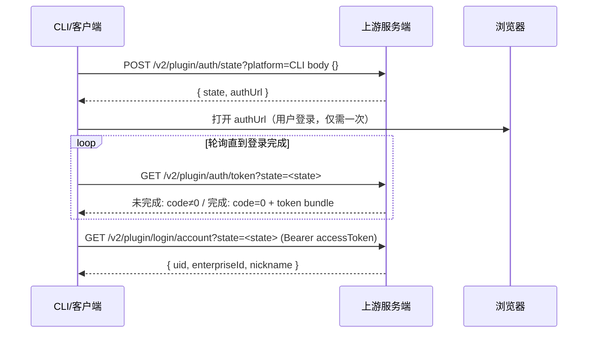

# OAuth 原理 —— GitHub 参考实现（WorkBuddy2api-panel）

> 来源：`github.com/linguo2625469/WorkBuddy2api-panel` 的 `cmd/login/main.go`
> （raw 拉取于 2026-09-26，文件头注释自述「WorkBuddy OAuth 登录（设备授权流程，CN realm）」）。
> 本文档只记录**参考实现声称的原理**，尚未与官方客户端印证——印证结论见
> 《OAuth验证-WorkBuddy本地逆向.md》。

## 一、流程总览：服务端签发 state 的设备授权流

这不是标准 RFC 8628 设备授权（没有 `device_code` / `user_code` / `verification_uri`），
而是 WorkBuddy 自有变体：**state 由服务端签发，客户端拿 state 轮询 token**。



三个端点，前两个**无凭据**（登录还没发生），第三个带 `Authorization: Bearer`。

## 二、端点与 realm

按 realm 切换上游端点与 Origin/Referer（`realmConfig()`）：

| realm | 上游 base | Origin / Referer |
|---|---|---|
| `cn`（默认） | `https://copilot.tencent.com` | `https://www.codebuddy.cn` |
| `global` | `https://www.workbuddy.ai` | `https://www.workbuddy.ai` |

- 请求头固定带：`Content-Type: application/json`、`Accept: application/json, text/plain, */*`、
  `X-Requested-With: XMLHttpRequest`、`Origin`、`Referer`、`User-Agent: CLI/2.63.2 CodeBuddy/2.63.2`
- 每个流程独立 cookie jar（`oauth.go:22-29`：多账号登录互不串会话）

## 三、逐步细节（`cmd/login/main.go` 实测逻辑）

### 1. url 子命令（`runURL`）

```http
POST {base}/v2/plugin/auth/state?platform=CLI
body: {}
```

响应为统一信封 `{code, msg, data}`（`doJSON` 与 `main.go:429-433`、`oauth.go:33-66` 一致：
`code != 0` → error）。取 `data`：

```json
{ "state": "<服务端签发>", "authUrl": "https://...（浏览器打开）" }
```

state 落盘 `{state, realm}` 到临时文件（带 realm 是为了 poll 时**防混域**：
`validateRealmMatch` 校验 state 文件的 realm 与命令行 `--realm` 一致）。

### 2. poll 子命令（`runPoll`）

```http
GET {base}/v2/plugin/auth/token?state=<state>
```

- **pending**（浏览器还没登录完）：业务 `code != 0`（注释原文「login ing」），代码按「未完成」处理
- **完成**：`code = 0`，`data`：

```json
{ "accessToken": "...", "refreshToken": "...", "expiresIn": 5184000, "domain": "..." }
```

`auth/token` 被称为「权威登录状态端点」（`handlePollLogin`，`oauth.go:108-162`）。

接着取账号：

```http
GET {base}/v2/plugin/login/account?state=<state>
Authorization: Bearer <accessToken>
```

```json
{ "uid": "...", "enterpriseId": "...", "nickname": "..." }
```

最终输出合并 token + account + realm（realm 按 `domain` 推断或显式 `--realm`）。

### 3. 刷新（参考实现配套的 `internal/upstream/client.go`）

```http
POST {base}/v2/plugin/auth/token/refresh
body: 空
```

响应同 token bundle；`expiresIn` 恒 5184000（60 天），**两个 token 总是一起 rotate**。

## 四、安全设计要点（该实现的结论）

1. **无 PKCE**：注释原文「无 PKCE（workbuddy 设备流由服务端签发 state）」。
   授权 URL 里没有 `code_challenge`，安全性依赖服务端 state 的一次性绑定。
2. **state 防混域**：state 落盘带 realm，poll 读回校验，url 与 poll 必须同一 realm。
3. **信封纪律**：所有响应走 `{code,msg,data}`，`code!=0` 一律当错误；HTTP ≥300 也当错误。
4. **UA 伪装为官方 CLI**：`CLI/2.63.2 CodeBuddy/2.63.2`（与 Origin/Referer 一起构成准入三件套）。
5. **platform=CLI 是显式查询参数**，标记本次登录的客户端类型。
