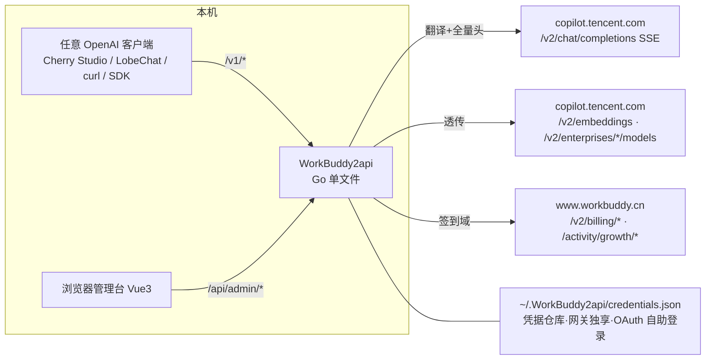

# WorkBuddy 网关成品设计文档

> 版本 v1.0 · 2026-09-26 · 基于本目录四份协议文档的实测结论（WorkBuddy 5.6.2 · CN）。
> 定位：把逆向出的协议沉淀成**可分发、可长期运行**的本地成品——OpenAI 兼容网关 + Web 管理台。

---

## 一、目标与定位

**做出来的是什么**：一个本地常驻的 `WorkBuddy2api` 服务，对外暴露**标准 OpenAI 兼容 API**，
把请求翻译后转发到 WorkBuddy 官方网关；同时内置一个 Web 管理台，管凭据、看用量、调模型。

**解决的真实痛点**：

| 痛点 | 成品的回答 |
| --- | --- |
| 上游强制 `stream:true`，不支持流式的客户端用不了 | 网关服务端聚合 SSE，**补齐非流式** `chat.completions` |
| SSE 帧格式与 OpenAI 标准有 4 处不同（`finish_reason:""`、usage 内联、delta 7 键、tool_calls 合并） | 网关统一翻译成 OpenAI 标准帧 |
| 凭据引导 / 60 天续期目前散落在签到脚本里 | 网关内置凭据管理器，自动引导 + 后台定时续期 + 401 自动重试 |
| credit 消耗不可见 | 每次请求记录 `usage.credit`，管理台按天汇总 |
| 现有 Python 脚本只是"参考客户端"，不是可分发的服务 | Go 单文件二进制（`go:embed` 打包前端），拷走即用 |

**非目标**（写清楚，防蔓延）：

- 不做上游不可用路由的补齐：`/responses`（502）、`/v2/completions`（无可用模型）、
  `/v2/images/generations`（无有效模型名）——本地对应端点返回 501 + 说明。
- 不破解桌面端令牌 envelope 加密（沿用明文备份 + refresh 引导路线）。
- 不做多用户 / 多账号池；单机单账号（多账号用 `--uid` 前缀切换，同签到脚本语义）。

---

## 二、技术选型

### 2.1 后端：Go（已定）

| 理由 | 说明 |
| --- | --- |
| SSE 流式透传 | `net/http` 原生 `Flusher` + 长连接，逐帧转发无压力 |
| 单文件分发 | `go build` 出一个 exe，前端产物 `go:embed` 进去，零运行时依赖 |
| 后台任务 | goroutine 做定时续期 / 心跳判死，天然契合 |
| 与现有资产关系 | Python 签到/聊天脚本**保留**（运维侧工具），网关不依赖它们，凭据完全独立（见 5.1） |

**Go 侧坚持零第三方依赖**（仅标准库：`net/http`、`embed`、`encoding/json`、`sync`）。
配置用 JSON，不用 YAML（省掉解析库）。

### 2.2 前端：Vue 3（选型对比）

| 维度 | **Vue 3 ✅** | React |
| --- | --- | --- |
| 页面体量 | 管理台 5 个页面，Vue SFC 一个页面一个文件 | 组件拆分更碎，小项目里是仪式感 |
| 组件库 | Naive UI / Element Plus（中文文档、管理台组件全） | Ant Design 同样全 |
| 流式渲染 | `ref` + 逐帧 push 即可 | 同样可行 |
| 生态惯性 | 本项目全部文档与脚本都是中文语境，Vue 中文资料密度更高 | — |

结论：**Vue 3 + TypeScript + Vite + Pinia + Naive UI**（Composition API + `<script setup>`）。
React 在这个场景没有可量化的增益，不为选型而选型。

### 2.3 数据存储

用量与日志用 **JSONL 追加文件 + 内存聚合**（启动时重放做按天汇总）。
不上 SQLite：单机单用户的数据量（每天几十到几百条请求）配数据库是过度设计，且避免 CGO。

---

## 三、总体架构



三个关键边界：

1. **本地 API 与管理台同一进程**：`/v1/*` 是 OpenAI 兼容面，`/api/admin/*` 是管理面；
   生产模式前端静态资源从 embed FS 提供，开发模式走 Vite 代理。
2. **凭据完全独立**：网关用自己的 credentials.json（与签到脚本 auth.json 格式解耦）。
   账号通过官方 OAuth 设备授权流自助登录添加（state → authUrl → 浏览器登录 → 轮询 token），
   服务端无浏览器依赖，适配 Docker/Linux 部署。
3. **上游三域**：聊天/模型走 `copilot.tencent.com`，签到/成长走 `{domain}`（`www.workbuddy.cn`），
   与现有脚本一致，不要混。

---

## 四、目录结构

```
WorkBuddy/
├── WorkBuddy2api/                        # 新项目根（现有文档/脚本原地不动）
│   ├── cmd/WorkBuddy2api/main.go       # 入口：flag 解析、装配、启动
│   ├── internal/
│   │   ├── config/config.go        # 配置加载/落盘（config.json）
│   │   ├── credential/             # 凭据管理器
│   │   │   ├── store.go            #   读写独立 credentials.json（原子写；Docker 挂 volume 持久化）
│   │   │   ├── oauth.go            #   OAuth 设备授权：POST auth/state → authUrl → 轮询 token/account
│   │   │   └── manager.go          #   定时续期(6h阈值) / 401触发续期 / 多账号
│   │   ├── upstream/               # WorkBuddy 官方网关客户端
│   │   │   ├── headers.go          #   全量头：会话级(进程内固定)+请求级(逐请求)
│   │   │   ├── chat.go             #   /v2/chat/completions SSE 逐行读取
│   │   │   ├── models.go           #   /v2/enterprises/{id}/models
│   │   │   ├── embeddings.go       #   /v2/embeddings 透传
│   │   │   └── growth.go           #   签到/状态/成长中心（管理台用）
│   │   ├── bridge/                 # ★ 协议翻译层（成品的核心价值）
│   │   │   ├── request.go          #   OpenAI 请求 → 上游请求（校验/裁剪/tool_choice 映射）
│   │   │   ├── stream.go           #   上游 SSE → OpenAI 标准流（含 include_usage）
│   │   │   ├── aggregate.go        #   上游 SSE → 完整 chat.completion（非流式补齐）
│   │   │   └── errors.go           #   两套错误信封 → OpenAI error 结构
│   │   ├── api/                    # 本地 HTTP 面
│   │   │   ├── openai.go           #   /v1/chat/completions /v1/models /v1/embeddings
│   │   │   ├── admin.go            #   /api/admin/*（管理台 REST）
│   │   │   └── middleware.go       #   本地鉴权 / panic 恢复 / CORS(dev)
│   │   ├── usage/                  # JSONL 记录 + 按天聚合
│   │   └── web/web.go              # go:embed 前端产物
│   ├── web/                        # Vue 3 前端
│   │   ├── src/
│   │   │   ├── views/              #   Dashboard / Playground / Models / Logs / Settings
│   │   │   ├── stores/             #   Pinia：overview / models / logs / settings
│   │   │   └── api/                #   fetch 封装 + EventSource
│   │   └── vite.config.ts          #   dev 代理 /v1、/api → 127.0.0.1:8787
│   └── config.json                 # 默认配置
└── （现有：README.md、四份协议文档、workbuddy_chat.py；签到脚本已并入 workbuddy2api/checkin.py）
```

---

## 五、后端设计

### 5.1 凭据管理器（`internal/credential`）

**账号获取走官方 OAuth 设备授权流**（逆向实锤，见《OAuth验证-WorkBuddy本地逆向.md》）：

```
管理台「添加账号」→ POST {base}/v2/plugin/auth/state?platform=CLI
  → 返回 {state, authUrl}；用户在自己电脑浏览器打开 authUrl 登录（服务端无需浏览器）
  → 网关轮询 GET auth/token?state=，code=11217/12151 为 pending，
    code=0 取 {accessToken, refreshToken, expiresIn, domain}
  → GET login/account?state= 取 uid/nickname → 存入 credentials.json
日常 → 到期前 6h 后台定时续期（POST auth/token/refresh，X-Refresh-Token 头，
       两 token 一起 rotate 写回）
运行中 → 上游 401 时：加锁续期一次 → 重试一次 → 仍 401 才报错
       （防雪崩：并发 401 只放一个 goroutine 去续期，其余等锁后用新 token）
```

- 凭据文件默认 `~/.WorkBuddy2api/credentials.json`（多账号数组），
  Docker 部署挂 volume 持久化；与签到脚本 auth.json 无任何读写关系。
- 桌面端明文备份引导（Windows 专用）降级为可选导入功能，非主路径，不进 M2。
- 令牌只在内存与 credentials.json 出现；日志、管理台 API、错误信息一律不回显原文。

### 5.2 上游客户端（`internal/upstream`）

- **头策略照抄 `workbuddy_chat.py` 的分工**：会话级头（`X-Conversation-ID` 等）进程内固定，
  请求级头（`X-Conversation-Message-ID`、`X-Request-ID`、trace 三件套）逐请求生成。
  官方注释点名：会话级头逐请求变化会把一次操作拆成几十个网关会话。
- **SSE 读取**：逐行迭代（绝不整读）、先判 `[DONE]` 再 parse、跳过 `: heartbeat` 注释帧、
  坏帧容错单帧跳过、`Accept-Encoding: identity` 防代理缓冲。
- **心跳判死**：60s 无任何字节视为连接死亡（官方 570s 总超时）。

### 5.3 协议翻译层（`internal/bridge`）—— 成品核心

**请求方向（OpenAI → 上游）**：

| OpenAI 入参 | 处理 |
| --- | --- |
| `model` 缺省 | 用配置默认 `glm-5.3`；`default` 显式映射为 `glm-5.3`；`kimi-k3` 透传（上游别名） |
| `stream` 任意值 | **一律改写为 `true`**（上游硬要求），原值记下来决定输出模式 |
| `tool_choice` 对象 | 映射为字符串 `{"type":"function",...}` → `"auto"`（上游只接受字符串，传对象必 400）；有损，README 标注 |
| `tools` | 透传 |
| `stream_options.include_usage` | 摘出来记在本地，上游不开也照样有 usage |
| 其余采样参数 | 白名单透传（temperature/top_p/max_tokens/stop/seed/…），未知键丢弃 |

**响应方向（上游 SSE → OpenAI 标准）**，四条实测规则逐一翻译：

| # | 上游事实 | 网关输出 |
| --- | --- | --- |
| 1 | 进行中 `finish_reason` 是 `""` | 输出 `null`（OpenAI 标准） |
| 2 | `usage` 内联在收尾帧、`choices` 非空 | 客户端要了 `include_usage` → 追加一帧 `choices:[]` + usage 再 `[DONE]`；没要 → 保持内联（两种客户端都兼容） |
| 3 | `delta` 每帧 7 键齐全（空值 `""`/`[]`/`null`） | 只输出非空键；`reasoning_content` 非空时保留为扩展字段 |
| 4 | `tool_calls` 按 `index` 合并、id/name 只在首帧、arguments 是片段 | 流式：增量原样透传（OpenAI 客户端自己按 index 拼）；非流式：网关合并后输出完整 `message.tool_calls[].function.arguments`（拼接完的字符串，与 OpenAI 语义一致） |

**非流式聚合**：`stream:false` 时网关在服务端跑完整个上游 SSE 流，聚合成一个
`chat.completion` JSON（`choices[0].message` 含 `content` / `reasoning_content`(扩展) /
`tool_calls`；`finish_reason` 取上游收尾值；`usage` 取收尾帧）。

**错误归一**（两套上游信封 → 一套 OpenAI `error`）：

| 上游 | 归一输出 |
| --- | --- |
| 扁平码 `{code:11101,msg,displayMsg,...}` | `{"error":{"message":msg+"（displayMsg.zh）","type":"workbuddy_error","code":"11101"}}`，HTTP 状态沿用上游 |
| OpenAI 嵌套 `{error:{...}}`（/responses 族） | 原样透传 |
| `401` HTML（APISIX 层） | 先触发续期重试一次；仍失败 → 502 + JSON error（**绝不**把 HTML 吐给客户端） |

### 5.4 本地 API

| 方法 路径 | 说明 |
| --- | --- |
| `POST /v1/chat/completions` | 流式 / 非流式双模式（见 5.3） |
| `GET /v1/models` | 代理 `/v2/enterprises/{personal\|eid}/models` → `{object:"list",data:[{id,object:"model",owned_by:vendor,…原字段}]}`（30 模型） |
| `POST /v1/embeddings` | 透传（上游本就 OpenAI 兼容；模型目前仅 `bge-m3` 可用） |
| `POST /v1/completions` · `/v1/responses` · `/v1/images/generations` | `501` + 说明（上游不可用，见「非目标」） |
| `GET /api/admin/overview` | 账号 / 令牌有效期 / 今日 credit / 今日请求数 / 连登天数 |
| `GET /api/admin/models` | 原始模型目录（含 agents / productFeatures） |
| `GET /api/admin/logs` | 用量记录分页（时间、模型、tokens、credit、finish、耗时） |
| `POST /api/admin/credential/refresh` | 手动续期 |
| `POST /api/admin/checkin` · `GET /api/admin/checkin` | 手动签到（幂等）/ 签到状态 |
| `GET /api/admin/streak` | 成长中心连登状态（只读展示；兑换/抽奖不做——消耗资源不可逆） |
| `GET/PUT /api/admin/settings` | 端口、默认模型、本地 API Key 等 |

**本地鉴权**：默认只绑 `127.0.0.1`；配置了 `api_key` 时 `/v1/*` 与 `/api/admin/*` 都要求
`Authorization: Bearer <key>`（本地 Key 与上游令牌无关，只是局域网防蹭）。未配置时仅监听回环。

### 5.5 用量记录（`internal/usage`）

每次聊天请求落一行 JSONL：`{ts, model, prompt_tokens, completion_tokens, thinking_tokens, credit, finish, latency_ms, client}`。
内存按天聚合（credit 合计、请求数、模型分布），启动时重放最近 30 天文件恢复。

### 5.6 配置（`config.json`）

```json
{
  "listen": "127.0.0.1:8787",
  "api_key": "",
  "default_model": "glm-5.3",
  "enterprise_id": "personal",
  "auth_store": "~/.WorkBuddy2api/credentials.json",
  "usage_dir": "~/.WorkBuddy2api/usage",
  "log_level": "info"
}
```

---

## 六、前端设计（Vue 3 管理台）

| 页面 | 内容 |
| --- | --- |
| **仪表盘** | 账号卡片（uid/域名/令牌剩余天数）、今日 credit 与请求数、连登天数、签到按钮、模型总数 |
| **对话调试** | 模型下拉（来自 /v1/models）、系统提示词、流式输出（含思维链折叠区）、tool_calls 展示、credit 消耗显示 |
| **模型目录** | 30 模型表格（厂商/上下文/是否支持工具/图像/思维链），13 个 agent 折叠面板 |
| **用量日志** | 按天汇总条 + 明细分页表 |
| **设置** | 监听地址 / API Key / 默认模型，手动续期按钮 |

技术要点：`<script setup>` + TS；SSE 用 `fetch` + `ReadableStream` 解析
（EventSource 不支持 POST）逐帧 push 进响应式数组；Naive UI 暗色适配。

---

## 七、协议事实基线（实现的验收依据）

全部来自本目录四份文档的**实测结论**，实现与测试以此为准：

1. `stream:true` 缺失 → 上游 `400/11101`；`tool_choice` 对象 → 必 400。
2. 进行中 `finish_reason:""`；usage 只在收尾帧且 `choices` 非空；`delta` 7 键齐全。
3. `tool_calls` 按 `index` 合并；id/name 只在首帧；arguments 拼接后再解析。
4. 错误两套信封：扁平码族（chat/embeddings/completions/images）与 OpenAI 嵌套族（/responses）；
   `code` 是通用码，语义看 `msg`；`401` 是 HTML。
5. 模型：`glm-5.3` 默认可用；`kimi-k3`=`kimi-k3-1` 别名；`default`→`glm-5.3`；
   embeddings 仅 `bge-m3`；`gpt-5.6-sol` 等需授权（11102）。
6. 头：仅 `Authorization` + `Content-Type` 即可 200；会话级头须稳定（拆会话问题）。
7. 凭据：refresh 60 天、双 token 同 rotate；账号经 OAuth 设备流自助登录添加（无浏览器依赖），
   pending 码 11217(token)/12151(account)；签到/用量已实测（cn 域，无需图灵盾头）。
8. **（2026-10-10 补）参数接线拿「行为证据」而不是「200」**：上游把 body 反序列化进固定
   Go 结构体——结构体外的键静默丢弃、非法取值默许，只有类型不符才 `400/11101`。
   已实测无效、**不得接线**的：`stop`（不截断）、`response_format`（不出 JSON）、`logprobs`（恒 `null`）、
   `seed`（同种子不同答）、`top_k`、`top_p`（不收敛）、`max_completion_tokens`（需网关重映射）。
   真生效并已接：`max_tokens`、`tools`、`tool_choice`（仅字符串）、`temperature`、`reasoning_effort`。
   → **接一个上游不会执行的参数 = 造出假接口，属于引入缺陷而非修复。**
9. **目录 ≠ 可调清单**：`/v3/config` 会把本账号调不动的模型也列出来（实测 55 个里
   17 个直连即 `400/11102 service info not found`），得实一发才能区分。

---

## 八、安全与边界

- 监听回环优先；设置 `api_key` 才考虑监听局域网。
- 令牌不出现在日志 / 管理台响应 / 错误信息；credentials.json 用 0600 权限，Docker 挂载卷注意属主。
- 只调用 WorkBuddy 官方域名；不读取宿主机桌面端任何文件。
- 聊天真实消耗 credit → 管理台显著展示；Playground 默认 `max_tokens` 限幅。
- 成长中心只做只读展示，兑换/抽奖不入成品（消耗资源不可逆）。

---

## 九、里程碑

| 里程碑 | 内容 | 验收标准 |
| --- | --- | --- |
| **M1 后端主干** | 凭据管理器 + upstream/bridge + `/v1/chat/completions`（流式与非流式）+ `/v1/models` + `/v1/embeddings` | curl 非流式拿到标准 `chat.completion`；流式帧符合 OpenAI 标准；401 自愈一次 |
| **M2 运维面** | 用量 JSONL + 错误归一 + 501 端点 + config + 后台续期 | 任意 OpenAI SDK 直连可用；重启后用量汇总恢复 |
| **M3 管理台** | Vue 3 五页面 + admin API | 浏览器完成：OAuth 添加账号、看用量、调模型、手动签到/续期 |
| **M4 打包** | `go:embed` 单文件 + README + 开机自启说明（任务计划程序） | 双击 exe 即用，无需 Go/Node 环境 |

---

## 十、风险

| 风险 | 应对 |
| --- | --- |
| 上游协议随版本漂移（5.6.2 基线） | 翻译层集中在一个包；协议事实基线（第七节）逐条可复测；漂移时只改 bridge |
| 令牌明文备份依赖桌面端行为 | 引导失败给出明确指引（重登桌面端）；续期链路保证日常不再依赖引导 |
| credit 意外消耗 | 用量面板 + Playground 限幅；文档显著标注 |
| 流式长连接被代理/休眠打断 | `Accept-Encoding: identity`；心跳判死 + 客户端断开即停读上游 |
